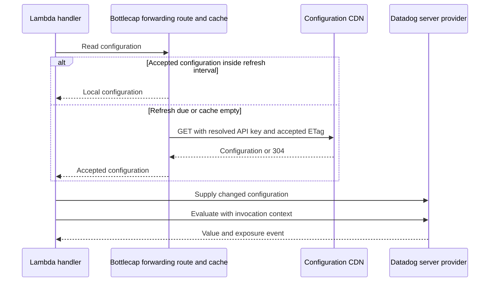

# Bottlecap feature flag configuration cache prototype

This example runs the real Datadog Lambda Extension with a configuration cache in its existing flag forwarding route. The extension owns CDN refresh. A Lambda handler supplies its configuration to the published Datadog Node server provider and evaluates flags locally.

The example uses `@datadog/openfeature-node-server` 2.7.0 and OpenFeature 1.23.0. It calls `DatadogNodeServerProvider.setConfiguration()`. This provider has no configuration poller. The application does not configure an SDK CDN transport.

## Run

Requirements: the repository's Rust toolchain and build prerequisites, Node.js 22 or later, and npm.

From this directory:

```sh
npm ci --ignore-scripts --no-audit --no-fund
npm test
```

The Rust process tests build and run the actual `bottlecap` binary. They provide a fake Lambda Extensions API and a fake CDN. They start `app.mjs` as a separate Node process. No AWS account or Datadog credentials are required.

The `test-mode` Cargo feature enables `DD_TEST_FLAG_CONFIG_BASE_URL` for the local fake CDN. The cache uses the same forwarding route and API key resolution as the normal extension. Normal builds ignore this test URL override.

The application exports a Lambda `handler`. Its command-line interface accepts one JSON invocation per line. Responses include the evaluation, configuration version, cache source, exposure events, and loaded SDK path.

A supported SDK integration should package the configuration-loading step. Customers should not need to copy this handler's bootstrap code.

## Customer controls

Caching is disabled by default. Without the opt-in, the extension keeps its current passthrough behavior.

| Environment variable | Behavior | Default |
| --- | --- | --- |
| `DD_SERVERLESS_FLAG_CONFIG_CACHE_ENABLED` | Enable the experimental cache | `false` |
| `DD_SERVERLESS_FLAG_CONFIG_CACHE_TTL` | Minimum interval between successful CDN checks, in seconds | `30` |
| `DD_SERVERLESS_FLAG_CONFIG_CACHE_MAX_AGE` | Maximum age since successful CDN validation, in seconds | `300` |
| `DD_SERVERLESS_FLAG_CONFIG_CACHE_TIMEOUT` | Total API-key, cache-wait, and refresh budget, in seconds | `0.1` |
| `DD_SERVERLESS_FLAG_CONFIG_CACHE_FAILURE_BACKOFF` | Delay before retrying a failed refresh, in seconds | `1` |

The duration settings accept numeric seconds, including fractions. The refresh interval cannot exceed the maximum accepted age. Invalid duration combinations keep passthrough enabled.

The handler checks the local extension on every invocation. It supplies rules only when their ETag changes. It retains the SDK's exposure deduplication across warm invocations. An invocation can request a smaller wait through `X-Config-Budget-Ms`. This header cannot increase the extension's configured timeout.



On a failed refresh, Bottlecap can return accepted configuration within the maximum age. Once that age expires, the handler withdraws SDK rules. The real SDK then returns the application default with an error. A later successful refresh restores evaluation. An upstream 4xx response, except 429, withdraws cached rules immediately.

The CDN remains the source for initial configuration and refreshes. A 304 revalidates the accepted snapshot and resets its age. Conditional requests still count as CDN requests.

## Test contracts

The process tests exercise the real binary and SDK:

- Simulate 105 Lambda invocations with caching enabled and disabled. Assert configured values that differ from the application default. Compare one CDN fetch with 105 passthrough requests.
- Retain one Bottlecap process across five fresh Node SDK processes. Assert that each SDK initializes and evaluates from the extension.
- Start three independent Bottlecap processes. Assert that each needs its own initial CDN fetch.
- Update configuration and assert that evaluation and exposure events change together.
- Fail refreshes and assert stale fallback, maximum-age expiry, SDK defaults, recovery through a 304, and rejection after credentials are revoked.
- Stop and resume both real processes with `SIGSTOP` and `SIGCONT`. Revalidate through a 304 and assert retained configuration and exposure state. This simulates process suspension; it does not validate Lambda freeze or SnapStart.
- Send 32 concurrent local reads and assert one authenticated CDN fetch. Assert full decoded configuration and local conditional responses.
- Complete runtime telemetry, observe subsequent Extensions API `/next` requests, and shut down each real extension process without a panic.

The forwarding unit tests also cover query and credential isolation, invalid refreshes, failure backoff, bounded waits, and an empty-cache 304. Existing forwarding tests cover authentication failures, redirects, environment selection, and unsupported routes.

`app.mjs` captures exposure events locally for assertions. This example does not deliver those events to Datadog. Its passthrough comparison measures this application's request pattern. It does not measure current customer traffic or imply that all shipped SDKs fetch once per invocation.

## State and production limits

The cache belongs to one execution environment. It is stored in the real extension process, below the SDK. It has no background refresh timer. Reads check elapsed time, so they do not depend on a poller running while Lambda is idle.

A fresh Lambda execution environment still needs initial configuration. A Lambda reset can restart both the runtime and extension. This prototype stores no disk snapshot. Restarting Bottlecap loses its cache. The five-SDK-process test isolates state below SDK initialization; it does not claim that the extension outlives a real Lambda reset.

The prototype limits each response to 8 MiB and each process to eight configuration scopes. A scope includes the full upstream URL, resolved API key, and Accept header. It requests uncompressed CDN responses so it can validate the JSON envelope. A full scope map rejects new scopes. Eviction and configurable memory limits remain follow-up work.

The Node handler assumes serial invocations, as in standard on-demand Lambda. Managed Instances need separate application concurrency validation. Complete UFC semantic validation, response-signing integration, resource overhead, and large-list compatibility also remain follow-up work. No AWS deployment has been tested. The tests do not establish AWS billing or production latency savings.

This draft keeps cache state next to Bottlecap's existing authenticated forwarding route. It does not introduce a general cache library. Before production reuse across serverless agents, the reusable cache contract should be reviewed with the Serverless Azure and GCP team and placed in `serverless-components`.

## Stateful extension precedents

- [AWS AppConfig Agent](https://docs.aws.amazon.com/appconfig/latest/userguide/appconfig-integration-lambda-extensions-how-it-works.html) serves a local configuration cache. Each execution environment has a separate cache. [Its controls](https://docs.aws.amazon.com/appconfig/latest/userguide/appconfig-integration-lambda-extensions-config.html) include polling interval, timeout, and prefetch.
- [AWS Parameters and Secrets Lambda Extension](https://docs.aws.amazon.com/systems-manager/latest/userguide/ps-integration-lambda-extensions.html) caches values for later invocations. It exposes local HTTP access with configurable TTL and cache size.
- [AWS's Go cache-extension example](https://aws.amazon.com/blogs/compute/caching-data-and-configuration-settings-with-aws-lambda-extensions/) demonstrates a separate cache process. It is a reference example, rather than evidence of customer adoption.
- [Lambda's execution environment lifecycle](https://docs.aws.amazon.com/lambda/latest/dg/lambda-runtime-environment.html) describes freeze, reuse, reset, and `/tmp` retention. Extension work contributes to execution duration.
