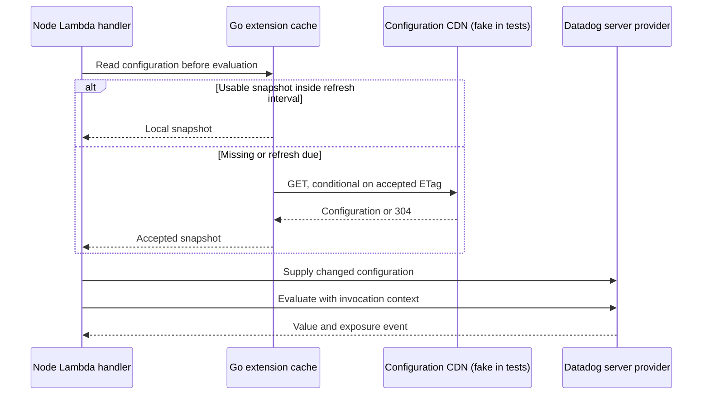

# Lambda feature flag configuration cache prototype

This example tests a configuration cache below the Lambda handler. The extension owns upstream refresh. The SDK evaluates supplied configuration locally.

The example uses the published `@datadog/openfeature-node-server` package, version `2.7.0`, with OpenFeature `1.23.0`. It does not implement a substitute evaluator. It supplies rules through `DatadogNodeServerProvider.setConfiguration()`. This provider has no configuration poller. The example does not configure an SDK CDN transport.

The Go process is an experimental external extension. It does not change Bottlecap or its production defaults. All tests use a local fake CDN. No Datadog credentials or AWS account are required.

When `AWS_LAMBDA_RUNTIME_API` is set, the process registers for INVOKE and SHUTDOWN events through the Extensions API. Layer packaging and deployment remain follow-up work.

## Run the example

Requirements: Go 1.23 or later, Node.js 22 or later, npm, and Linux or macOS. The freeze tests also require `ps`.

From this directory:

```sh
npm ci --ignore-scripts --no-audit --no-fund
npm test
```

The tests start the Go extension process and the Node application in separate processes. The application exports a Lambda `handler`. Its command-line interface accepts one JSON event per line. Each response includes the evaluation, configuration version, cache source, exposure events, and loaded SDK path.

## Configuration flow



The handler checks the local endpoint on each invocation. It supplies configuration only when the version changes. It retains SDK exposure deduplication across warm invocations. Exposure events are captured locally for assertions. This example does not send them to Datadog.

Refresh occurs on demand. No timer must run while Lambda freezes the environment. On the first read after an idle period, the extension checks elapsed time and refreshes when required.

The CDN remains the source for cache misses and refreshes. The cache does not replace the delivery service. A production integration could give customers these controls through extension configuration:

| Prototype option | Customer control |
| --- | --- |
| `-ttl` | Minimum interval between successful upstream checks for a configuration scope. Default: 30 seconds. |
| `-max-age` | Maximum age since successful upstream validation, including a 304 response. Default: 5 minutes. |
| `-timeout` | Maximum fetch and queue wait. Default: 100 milliseconds. |
| `-failure-backoff` | Delay before another failed refresh can be retried. Default: 1 second. |
| `-state-dir` | Optional directory for environment-local snapshots, such as `/tmp`. Disabled by default. |

An invocation can request a smaller wait through `X-Config-Budget-Ms`. This header cannot increase the configured timeout. On a failed refresh, the extension can return accepted configuration within `-max-age`. Once that limit expires, the handler withdraws SDK rules. The real SDK then returns the application default. A later successful refresh restores evaluation.

The cache groups requests by the full query and `Accept` header. The upstream URL identifies one trusted configuration source. Disk keys also include that URL. Concurrent reads of one scope share a fetch. A production cache must also isolate credentials, sites, organizations, and other source identifiers.

## What the tests demonstrate

| Scenario | Expected result |
| --- | --- |
| 100 warm invocations with the real SDK | 100 configured `true` results, distinct from the application's `false` default; one CDN request. |
| Same application with passthrough mode | 100 CDN requests. The SDK still has no poller. |
| Five fresh Node SDK processes with one live extension | One CDN fetch; each SDK initializes and evaluates locally. Exposure state remains per SDK process. |
| 32 concurrent reads in one cache | One CDN fetch. |
| Idle processes, then stopped and resumed processes | No idle polling; first resumed invocation refreshes and evaluates the changed value. |
| Fake Lambda Extensions API | Registration, two INVOKE events, cache availability during runtime work, and process exit on SHUTDOWN. |
| Outage or invalid JSON | Accepted rules remain available within the maximum age. Failed refreshes use backoff. |
| Slow upstream | Request budget bounds the wait. Warm state remains usable; an empty cache returns 503. |
| Maximum age expires | Real SDK returns its default with an error and no exposure. A later refresh recovers. |
| Process reset with the same snapshot directory | The replacement extension reads its environment-local snapshot. |
| 16 fresh extension processes with independent state | 16 initial CDN requests. |

Passthrough is a request-count control for this application. It forwards each local read, as the existing extension forwarding path does. It is not a measurement of current customer traffic or a claim that every shipped SDK fetches once per invocation.

The tests count CDN requests, including conditional requests. A 304 response saves response bytes; it still counts as a request. These tests do not establish pricing or billing savings.

## Lambda state and limits

A fresh Lambda execution environment needs initial configuration. Warm invocations can reuse state, but AWS does not guarantee environment reuse. The extension shares the environment's lifecycle. It does not survive replacement as an independent regional service.

The runtime-restart test isolates the benefit of state below SDK initialization. It restarts Node while preserving the extension. A real Lambda reset can restart both processes. The separate disk test models recovery when the same environment retains `/tmp`. A new environment cannot reuse another environment's `/tmp`.

The process pause tests use `SIGSTOP` and `SIGCONT`. They test elapsed-time refresh after process suspension. They do not validate Lambda's actual freeze mechanism, SnapStart, AWS billing duration, or production latency. No AWS deployment has been tested. The application assumes serial invocations, as in standard on-demand Lambda. Managed Instances need separate concurrency validation.

This cache can reduce repeated fetches within an environment. It cannot remove the initial fetch for each new environment during scale-out. A shared bootstrap source would require a separate design. A deployment artifact with configuration also needs update, revocation, and maximum-age rules.

## Existing stateful extension designs

- [AWS AppConfig Agent](https://docs.aws.amazon.com/appconfig/latest/userguide/appconfig-integration-lambda-extensions-how-it-works.html) serves a local configuration cache. Each execution environment has a separate cache. [Its controls](https://docs.aws.amazon.com/appconfig/latest/userguide/appconfig-integration-lambda-extensions-config.html) include polling interval, timeout, and prefetch.
- [AWS Parameters and Secrets Lambda Extension](https://docs.aws.amazon.com/systems-manager/latest/userguide/ps-integration-lambda-extensions.html) retains cached values for later invocations. It exposes a local HTTP endpoint with configurable TTL and cache size.
- [AWS's Go cache-extension example](https://aws.amazon.com/blogs/compute/caching-data-and-configuration-settings-with-aws-lambda-extensions/) demonstrates a separate cache process with a local HTTP interface. It is a reference example, rather than evidence of customer adoption.
- [Lambda's execution environment lifecycle](https://docs.aws.amazon.com/lambda/latest/dg/lambda-runtime-environment.html) describes freeze, reuse, reset, and `/tmp` retention. Extension work contributes to execution duration.

## Production follow-up

This example contains the proposed cache contract and a real SDK consumer in one directory. Customers should receive supported SDK integration. They should not need to copy this application's bootstrap code or operate a separate service.

The existing [Bottlecap forwarding path](../../bottlecap/src/traces/passthrough.rs) provides the production starting point. This prototype does not use that path's authentication. It only checks the response envelope and JSON structure. Production work needs complete configuration validation, response-signing integration, bounded cache size, credential isolation, and observable refresh failures. Large lists, memory overhead, startup overhead, and exposure delivery also need validation.

The current `serverless-components` source tree has no dedicated feature flag configuration-cache crate. Reusable Rust cache logic should live there if other serverless agents can use it. Bottlecap should own lifecycle and forwarding integration. This example does not select the production package boundary.
