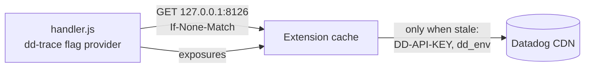

# Feature flags from the Extension's configuration cache

A Lambda-style Node handler that evaluates Datadog feature flags with the real
dd-trace flag provider (`dd-trace@6.25.0`, `tracer.openfeature`). The
configuration comes from the Extension, which caches it per execution
environment and is the only process that contacts the Datadog CDN.

This is a prototype. Nothing here has run in AWS Lambda.

## How it fits together



- `handler.js`: initializes the tracer once per environment. At the start of
  each invocation it reloads from the Extension, then evaluates `kill-switch`.
- `extension-config.js`: the local reload. A `304` keeps the provider's
  snapshot; a `200` replaces it.
- `fixtures/`: the CDN's JSON:API envelope around the `kill-switch` flag from
  [ffe-system-test-data](https://github.com/DataDog/ffe-system-test-data)
  (`ufc-config.json` at `84689ad6`). `ufc-v2.json` turns the flag on for everyone.

## Two ways to keep the SDK off the CDN

| Mode | SDK settings | Code | After a thaw |
|---|---|---|---|
| Reload per invocation (this handler) | `DD_FEATURE_FLAGS_CONFIGURATION_SOURCE=remote_config`, `DD_REMOTE_CONFIGURATION_ENABLED=false` | `extension-config.js` | The first invocation reads the Extension before it evaluates |
| SDK polls the Extension | `DD_FEATURE_FLAGS_CONFIGURATION_SOURCE=agentless`, `DD_FEATURE_FLAGS_CONFIGURATION_SOURCE_AGENTLESS_BASE_URL=http://127.0.0.1:8126` | None | The SDK's poll timer fires late, so the first invocation can evaluate the old snapshot |

The first mode uses `setConfiguration`, which `tracer.openfeature` has at
runtime but dd-trace does not type or document. It also unwraps the CDN
envelope itself and has to wait for OpenFeature's ready state after the first
load. A supported version needs an SDK API for this, for example a
`local` source that reloads on demand.

## Extension settings

| Variable | Default | Meaning |
|---|---|---|
| `DD_FEATURE_FLAGS_EXTENSION_CACHE_ENABLED` | `false` | Serve the route from the cache. Off: the route forwards each request, as before. |
| `DD_FEATURE_FLAGS_EXTENSION_CACHE_TTL_SECONDS` | `30` | Serve without contacting Datadog while the configuration is this young. |
| `DD_FEATURE_FLAGS_EXTENSION_CACHE_MAX_STALE_SECONDS` | `300` | If a refresh fails, keep serving the configuration up to this age, then answer `5xx`. |
| `DD_FEATURE_FLAGS_EXTENSION_CACHE_STARTUP_WAIT_MS` | `3000` | Longest a read waits for the first configuration. |
| `DD_FEATURE_FLAGS_EXTENSION_CACHE_REFRESH_WAIT_MS` | `500` | Longest a read waits for a refresh before it gets the stale configuration. |
| `DD_FEATURE_FLAGS_EXTENSION_CACHE_BOOTSTRAP_FILE` | unset | A CDN response shipped with the function. Used as fresh only while its `createdAt` is within the TTL, otherwise only as a fallback. |

Replies carry `ETag`, `Age` and `X-Datadog-Flag-Config-Cache: fresh | stale | bootstrap`.

## Run the tests

```bash
(cd ../../bottlecap && cargo build --features test-mode --bin bottlecap-test-mode)
npm ci
npm test
```

The tests start the real Extension (test-mode build, which reads
`DD_TESTMODE_FEATURE_FLAGS_CDN_URL`), a fake CDN, a fake trace agent, and one
Node process per simulated execution environment. Time-sensitive cache rules
(freeze and thaw, bounded waits) are tested with a fake clock in
`bottlecap/src/traces/flag_config_cache.rs`.
